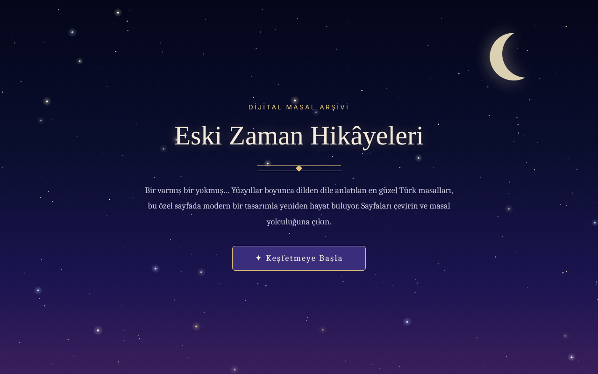
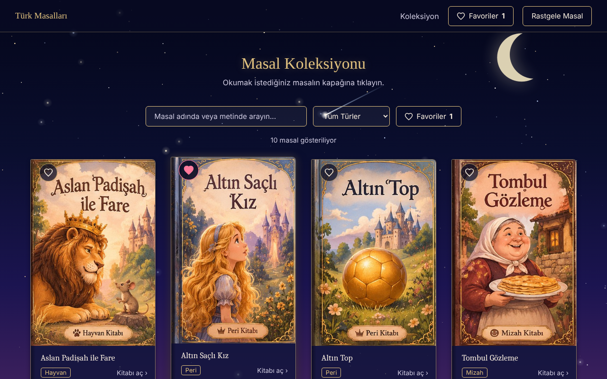
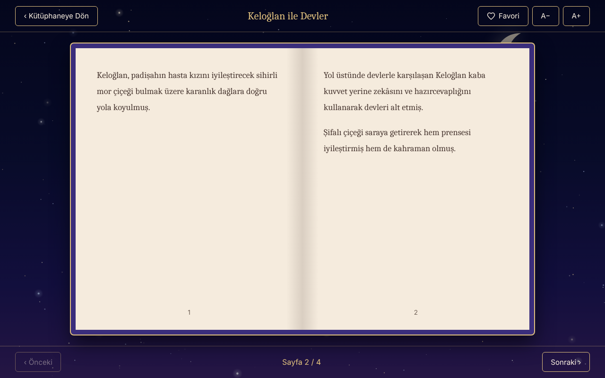
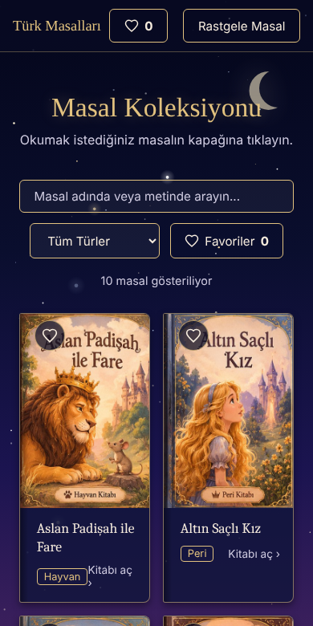

# Eski Zaman Hikâyeleri – Türk Masalları Derlemesi

Programlamaya Giriş dersi vize projesi: 10 Türk masalının okunabildiği bir web sayfası.
Bu sürümde proje, tek dosyalık yapıdan **üç ayrı dosyaya** (HTML + harici CSS + harici JavaScript) ayrılmıştır.

## Canlı Demo
GitHub Pages bağlantısı: `https://mariamhajjar50-oss.github.io/turk-masallari/`

## Ne yapar?
- Yıldızlı, kayan yıldızlı bir açılış sayfası; "Keşfetmeye Başla" düğmesiyle masal koleksiyonuna geçilir.
- Masalları başlıkta ve metinde arama, türe göre süzme.
- Masalları favorilere ekleme / çıkarma ve yalnızca favorileri gösterme (tarayıcıda saklanır).
- İki sayfalı kitap görünümünde okuma, yazı boyutunu değiştirme, ok tuşlarıyla sayfa çevirme.
- Okunan masalların işaretlenmesi.
- Bilgisayar ve telefon ekranına uyumlu tasarım.

## Bu sürümde yapılan değişiklikler (External CSS ve JS)
- `<style>` içindeki tüm stiller `style.css` dosyasına taşındı ve `<link rel="stylesheet" href="style.css">` ile bağlandı.
- `<script>` içindeki tüm kodlar `script.js` dosyasına taşındı ve `</body>` öncesinde `<script src="script.js"></script>` ile bağlandı.
- HTML içine base64 olarak gömülü olan masal görselleri ayrı `.jpg` dosyaları olarak çıkarıldı; `script.js` artık bu dosyaların adlarına başvuruyor.
- Satır içi `style="..."` kullanımı kaldırıldı, yerine `.bos-mesaj` CSS sınıfı eklendi.
- Tasarım ve işlevler önceki sürümle aynıdır.

## Dosya Yapısı
```
├── index.html        Sayfa iskeleti (HTML)
├── style.css         Tüm stiller (harici CSS)
├── script.js         Masal verisi, arama/süzme, favoriler, okuyucu, gökyüzü animasyonu (harici JS)
├── *.jpg             Masal kapak görselleri
├── ekran-*.png       Ekran görüntüleri
└── README.md
```

## Nasıl açılır?
Repoyu indirin (Code → Download ZIP) ve `index.html` dosyasını tarayıcıda açın. Başka bir kurulum veya internet bağlantısı gerekmez.
Tüm dosyalar `index.html` ile aynı klasörde durmalıdır.

## Ekran Görüntüleri





## Kullanılan Teknolojiler
HTML5, CSS3, JavaScript (kütüphanesiz), `localStorage`, Canvas API.

## Bağlantılar
- YouTube sunum videosu: https://youtu.be/QSVX8glw74g

## Not
Görsellerin kaynağı ve üretim ayrıntıları raporda belirtilmiştir.

## Geliştirici
Ad Soyad – Öğrenci No
